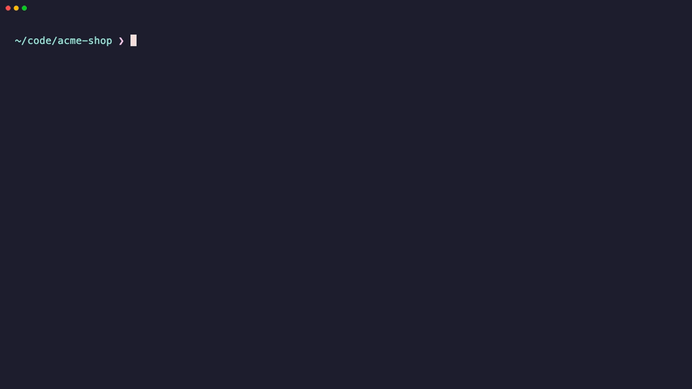

<div align="center">

# tidyup

**Your dev machine, minus the mess.**

Kill whatever is squatting on port 3000. Delete the 40 GB of `node_modules` and `target` folders from projects you forgot about. Start your whole dev stack with one command.

[](https://github.com/ChristiantangCC/tidyup/actions/workflows/ci.yml)
[](https://crates.io/crates/tidyup)
[](LICENSE)


</div>

## Why

Every developer has seen these:

```
Error: listen EADDRINUSE: address already in use :::3000
```

```
Your disk is almost full.
```

The first one sends you to Stack Overflow for the `lsof -ti :3000 | xargs kill` incantation, again. The second one is 30 old projects, each with a gigabyte of `node_modules`, a few Rust `target` folders at 5 GB each, and a `.venv` from that weekend you tried machine learning.

tidyup handles both: one small binary, no runtime, no config needed.

## Install

```sh
cargo install tidyup
```

A single 1.6 MB binary with nothing else to install. Works on macOS and Linux, using the `lsof` and `ps` both systems ship with.

## Ports: what's running, and stop it


```sh
tidyup ports          # what's listening, which process, which project folder
tidyup 3000           # stop whatever is on 3000
tidyup 3000 5173 8080 # several at once
tidyup kill 3000 -f   # skip the polite part
```

- **Shows the project folder** each process runs from, so you can tell your three `node` processes apart.
- **Hides system noise.** AirPlay, Spotify and other processes running from `/` stay out of the list unless you pass `--all`.
- **Stops nicely first.** SIGTERM, a 3 second wait, then SIGKILL only if the process is still around. That's what happened to the stubborn Python server above.
- **Knows Docker.** A port published by a container shows the container's name, and stopping it runs `docker stop` on that container instead of killing Docker itself.

## Clean: get your disk back


```sh
tidyup clean ~/code                  # pick from a list, then confirm
tidyup clean ~/code --older-than 30  # only projects untouched for a month
tidyup clean ~/code --dry-run        # just show me
tidyup clean ~/code --caches         # plus Xcode, npm, pnpm, Cargo, Docker and other caches
tidyup clean ~/code --trash          # move to the Trash instead of deleting
tidyup clean ~/code --older-than 90 --yes   # no questions asked
```

**It only deletes what your tools can rebuild**, and only when the project file that creates it sits next to it. A `node_modules` without a `package.json` beside it is left alone. So is a `build/` folder you made yourself.

| Deletes | When next to | |
| --- | --- | --- |
| `node_modules` `.next` `.nuxt` `.svelte-kit` `.turbo` `.parcel-cache` `.angular` | `package.json` | JavaScript |
| `target` | `Cargo.toml` · `pom.xml` | Rust · Maven |
| `build` `.gradle` | `build.gradle(.kts)` · `settings.gradle(.kts)` | Gradle |
| `.venv` `venv` | `pyproject.toml` · `requirements.txt` · `setup.py` · `Pipfile` | Python |
| `Pods` | `Podfile` | CocoaPods |
| `.dart_tool` `build` | `pubspec.yaml` | Dart · Flutter |
| `vendor` | `composer.json` | PHP |
| `_build` `deps` | `mix.exs` | Elixir |
| `.zig-cache` `zig-out` | `build.zig` | Zig |
| `bin` `obj` | `*.csproj` · `*.fsproj` · `*.vbproj` | .NET |
| `.build` | `Package.swift` | Swift |
| `build` `cmake-build-debug` `cmake-build-release` | `CMakeLists.txt` | CMake |
| `Library` `Temp` | `ProjectSettings/ProjectVersion.txt` | Unity |
| `Binaries` `Intermediate` `DerivedDataCache` | `*.uproject` | Unreal |
| `.terraform` | `*.tf` | Terraform |
| `.stack-work` `dist-newstyle` | `stack.yaml` · `cabal.project` · `*.cabal` | Haskell |
| `target` | `build.sbt` | Scala |
| `.godot` | `project.godot` | Godot |
| `.pixi` | `pixi.toml` | Pixi |
| `.nx` | `nx.json` | Nx |

**Global caches too.** With `--caches`, tidyup also lists the caches your tools keep outside any project: Xcode's DerivedData and simulator caches, npm, pnpm, Yarn, Bun, Cargo, Go, Gradle, Maven, pip, uv, Homebrew and CocoaPods. Docker's unused images and build cache show up as one item, removed with `docker image prune` and `docker builder prune`; volumes and running containers are never touched. On one working Mac this came to 135 GB.

**It never looks inside** hidden folders (`.git`, `.vscode`, `.cargo`, …), `.app` bundles or `~/Library`, so your editor extensions keep their `node_modules`.

**Sizes are honest.** tidyup reports what deleting actually frees. A pnpm project's `node_modules` is mostly hard links into pnpm's shared store, so it shows up small, because deleting it frees almost nothing.

**Age** is the last time you touched the project, not its build folder. `--older-than 30` means "projects I haven't opened in a month".

## Up: your dev stack in one command



Put a `tidyup.toml` in your project (or run `tidyup up --init`):

```toml
[[service]]
name = "web"
cmd = "pnpm dev"
port = 3000              # whatever holds this port is stopped first

[[service]]
name = "api"
cmd = "uvicorn main:app --port 8080"
port = 8080

[[service]]
name = "worker"
cmd = "pnpm worker"
cwd = "packages/worker"  # optional, relative to tidyup.toml
env = { LOG_LEVEL = "debug" }
```

```sh
tidyup up          # start everything
tidyup up web api  # just these
```

- **Frees the ports first**, so a leftover dev server from yesterday doesn't stop you.
- **One terminal, colored prefixes**, colors from your tools kept.
- **ctrl-c stops everything**, including the processes your services started themselves (`pnpm` → `node` → `esbuild`). No orphans holding port 3000 tomorrow.

## The dashboard

Run `tidyup` with no arguments (or `tidyup ui ~/code`) for both tools in one screen. Ports refresh every 2 seconds; the Clean tab fills in while it scans.

| Ports tab | | Clean tab | |
| --- | --- | --- | --- |
| `x` | stop | `space` | mark |
| `X` | force kill | `a` | mark all |
| `a` | show/hide system processes | `d` | delete marked (or current) |
| `r` | refresh | `s` / `t` | sort by size / age, again to flip |
| | | `c` | show/hide global caches |
| | | `r` | rescan |

`tab` or `1`/`2` switches tabs, `↑↓` or `j`/`k` moves, `q` quits.

## How it compares

tidyup does three jobs that usually take three tools. If you only need one of them, these are good too.

| | tidyup | [kondo](https://github.com/tbillington/kondo) | [npkill](https://github.com/voidcosmos/npkill) | [kill-port](https://github.com/tiaanduplessis/kill-port) |
| --- | --- | --- | --- | --- |
| Deletes dependency and build folders | 28 project types | 20+ project types | Node by default, more via profiles | – |
| Checks for the project file before deleting | Yes | Yes | No, matches folder names | – |
| Choosing what to delete | Pick from a list, then confirm | Asks per project | Interactive list | – |
| Only old projects | `--older-than 30` | `--older 1M` | Sort by age | – |
| Dry run | Yes | Yes | Yes | – |
| Package manager and Docker caches | Yes, with `--caches` | – | Some, matched by folder name | – |
| Stops what's on a port | SIGTERM, then SIGKILL after 3 s | – | – | SIGKILL |
| Starts your dev stack | `tidyup up` | – | – | – |
| Install | `cargo install` | Homebrew, winget, cargo | `npx` | `npx` |
| Windows | No | Yes | Yes | Yes |

## Contributing

Issues and pull requests are welcome. Before opening a PR:

```sh
cargo fmt && cargo clippy --all-targets -- -D warnings && cargo test
```

The GIFs above are recorded with [VHS](https://github.com/charmbracelet/vhs) against made-up data. `TIDYUP_DEMO=1` makes tidyup show fake ports and projects and only pretend to stop and delete them. To re-record one:

```sh
cargo build --release && sh demo/setup.sh && vhs demo/dashboard.tape
```

## License

[MIT](LICENSE)
